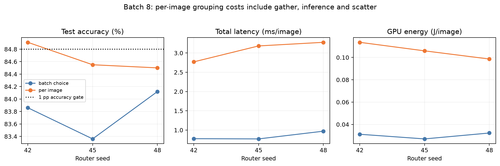
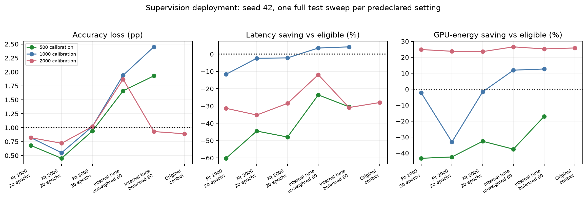
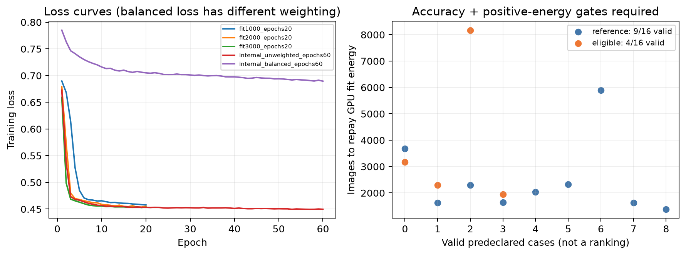
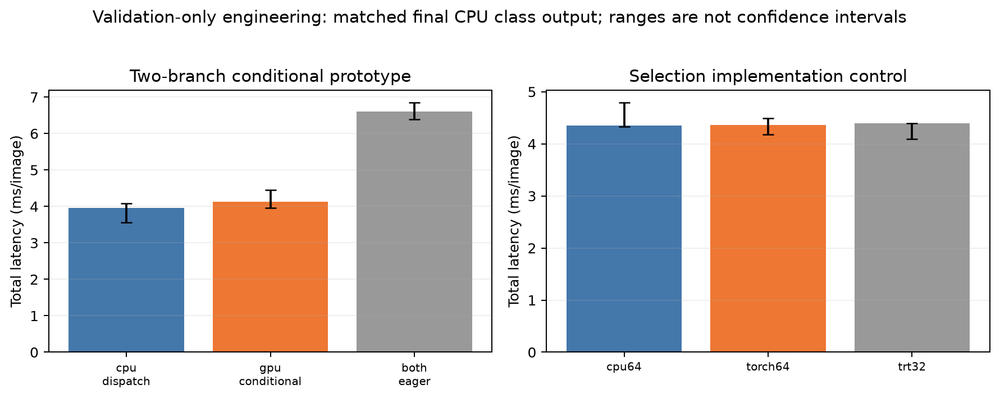

# Final compact-routing investigation summary

All authorized bounded measurement investigations are complete. The cancelled multi-day batch-1 matrix remains cancelled (8 full sweeps plus 6 preparation/pilot rows); the new studies are not an equivalent full 213-choice/capacity-2 matrix.

## Main findings

- Compact resident screen: 5/15 router cases pass accuracy; none also saves both latency and GPU energy versus eligible static.
- Switching confirmation: 7/15 accuracy passes. Seed42 resident graphs recorded 9.07% latency and 4.20% GPU-energy savings versus graph static. Cache-aware policies collapsed to constant R101 FP16; those gains are not dynamic-selection evidence.
- Batch8 per-image grouping improves accuracy but costs 2.77–3.28 ms/image versus 0.77–0.97 for one choice per batch. Only seed42 per-image passes the 1-point allowance.
- Final supervision screen: 9/16 accuracy passes; no case combines accuracy compliance with positive latency and GPU-energy savings versus eligible static.
- Genuine conditional execution verified only the selected branch runs, but measured 4.123 ms versus 3.955 ms CPU dispatch. It is an engineering prototype, not a validated 1-point routing policy.
- Dedicated R34 INT8 remains quarantined: 40/100 changed probe classes; exact numerical cause unresolved. Original engines retained.

## Coverage and audit index

- [correctness_training_energy_20261028](../../correctness_training_energy_20261028/audited_summary.json): audited.
- [gpu_residency_20261028](../../gpu_residency_20261028/audited_summary.json): audited.
- [b1_engine_profiles_20261028](../../b1_engine_profiles_20261028/audited_summary.json): audited.
- [b1_int8_diagnostic_20261028](../../b1_int8_diagnostic_20261028/audited_summary.json): audited.
- [compact_validation_20261028](../../compact_validation_20261028/audited_summary.json): audited.
- [compact_runtime_profile_20261028](../../compact_runtime_profile_20261028/audited_summary.json): audited.
- [gpu_dispatch_20261028](../../gpu_dispatch_20261028/audited_summary.json): audited.
- [compact_resident_screen_20261028](../../compact_resident_screen_20261028/audited_summary.json): audited.
- [compact_switching_pilot_20261028](../../compact_switching_pilot_20261028/audited_summary.json): audited.
- [compact_switching_confirmation_20261028](../../compact_switching_confirmation_20261028/audited_summary.json): audited.
- [router_supervision_screen_20261029](../../router_supervision_screen_20261029/audited_summary.json): audited.
- [batch8_grouping_20261029](../../batch8_grouping_20261029/audited_summary.json): audited.
- [dispatch_controls_20261029](../../dispatch_controls_20261029/audited_summary.json): audited.
- [gpu_conditional_20261029](../../gpu_conditional_20261029/audited_summary.json): audited.
- [supervision_deployment_20261029](../../supervision_deployment_20261029/audited_summary.json): audited.

## Scope and limitations

GPU-only energy excludes CPU and the rest of the PC. No verified CPU/system energy meter was available through the checked interfaces. No CPU-router training payback is claimed. Fourteen historical short setup-energy intervals remain unavailable, not zero; separate aggregate load/context/cleanup cycles were measured instead.
Static timing varied substantially even for paired same-classifier controls. Separate sessions, one-repeat screens and three-repeat descriptive ranges do not justify general causal or precise uncertainty claims. All seeds, failures, negative savings and constant-policy collapse remain in the underlying tables.
Training payback is training GPU joules divided by comparator-minus-routed GPU joules/image, only when accuracy passes and saving is positive. Training scope excludes supervision/calibration/export and is not whole-pipeline deployment cost. Existing larger-batch results and payback plots are reused without reruns under correctness_b1_20261028/existing_only.
Batch-1 engine specialization, residency, host-byte caching, cleanup/reuse, switching-aware calibration, CUDA Graphs, selection precision/readback, cold/warm costs, fit/calibration quantity, loss/epochs, batch grouping and thermal/session controls were investigated. No new external data, classifier retraining, power changes or HPC work was performed.
Final GPU-resident class output was not compared against host-output baselines: the same final host-class boundary was retained for fair comparisons.

## Figures

